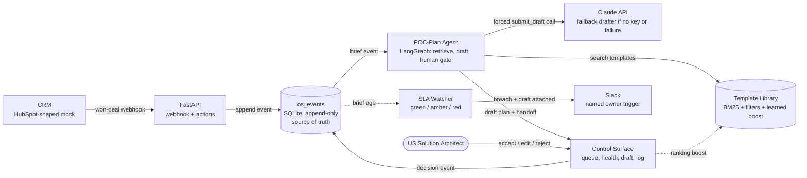

# RevenueOS: Brief-to-POC loop

RevenueOS closes the Sales to PreSales handoff gap (US SLA 2 business days, actual 6.8). A won deal arrives as a HubSpot-shaped event, an agent retrieves reusable templates and drafts an editable POC plan plus a Delivery handoff, and a US Solution Architect accepts, edits or rejects it.
Every decision is an event that re-ranks the template library, and the seam computes its own health and escalates on breach.
Everything shown is derived from one append-only event log (`os_events`).

## Status

- Automated tests (pytest) cover the events, SLA, retrieval, learning, state and ingest modules. The agent, API, watcher and UI were verified by scripted runs against the running app instead.
- The UI's manual click-through checklist has not been run.
- The Claude drafting path has only been exercised against a stub client. Without an API key the app runs in deterministic fallback mode and says so on screen.
- Known gaps and deferred work are listed in `docs/cut-list.md`. How it was built is in `docs/build-log.md`.

## Run it

```bash
python3 -m venv .venv && source .venv/bin/activate
pip install -r requirements.txt
cp .env.example .env        # optionally set ANTHROPIC_API_KEY, ANTHROPIC_MODEL, SLACK_WEBHOOK_URL
uvicorn revenueos.api:create_app --factory --port 8000
```

Open http://localhost:8000. The app resets and re-seeds on boot (four briefs at different ages). Built and run on Python 3.14.5, langgraph 1.2.20.

## Test it

```bash
pytest
```

Covers Tasks 0-6 only; see Status.

## Stack and why

Python, FastAPI and SQLite keep the whole thing one process and one file, which suits an 8-hour build and an event log that must be inspectable. LangGraph is used only for the agent flow, because its `interrupt` gives a real human gate between draft and decision. There is no vector database: the library is 12 templates, and explainable ranking (BM25 plus filters plus a learned boost, each with machine-built match reasons) matters more than semantic recall. SLA age, thresholds, triggers and ranking updates are plain Python because seam health is computed from events, not reported by an agent. Only draft generation calls an LLM (Claude via the Anthropic SDK, forced `submit_draft` tool call, Pydantic-validated, deterministic fallback).

## Architecture

`os_events` (append-only SQLite) is the single source of truth. The queue, seam health, reuse rate and ranking boosts are all derived by reading it. Interactive version (theme switch, zoom, relationship tracing): `docs/diagrams/revenueos-architecture.html`, open it in a browser.


The same architecture as text-rendered Mermaid:



Flow, in order:

1. A won deal arrives at `POST /webhooks/crm` and becomes a `brief.won` event. That starts the 2-day SLA clock.
2. The agent retrieves candidate templates (BM25, filters, learned boost), then asks Claude for a POC plan and Delivery handoff in one forced tool call. If there is no key, the call fails, or validation fails twice, a deterministic fallback drafter produces the same schema.
3. The graph pauses at a LangGraph `interrupt`. The Solution Architect accepts, edits or rejects on the control surface. Each decision is an event.
4. Decisions feed the ranking boost and the reuse rate. A reject re-ranks and redrafts.
5. The SLA watcher computes brief age in business days from events. On breach it writes `sla.breached` and `trigger.fired` to the named owner (Dana Whitfield) with the draft attached.

## Declared synthetic

All briefs, the 12 templates, the people (Marcus Reyes, Dana Whitfield), the accounts and the HubSpot webhook payloads are invented.

## Integration view for production

- HubSpot owns the won-deal webhook.
- Gong or Fireflies owns the call content behind the brief.
- Slack owns trigger delivery (a Slack-format payload is posted only if `SLACK_WEBHOOK_URL` is set).
- Notion or a database owns the template library.
- Clari would own the pipeline-health roll-up.

## Links

- Architecture diagram: `docs/diagrams/revenueos-architecture.html`
- Build log, cut list, human-judgement paragraph, demo script: `docs/`
